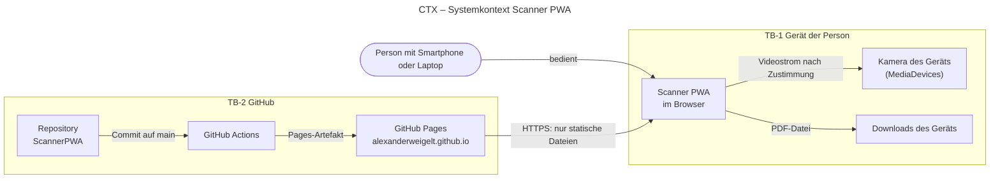
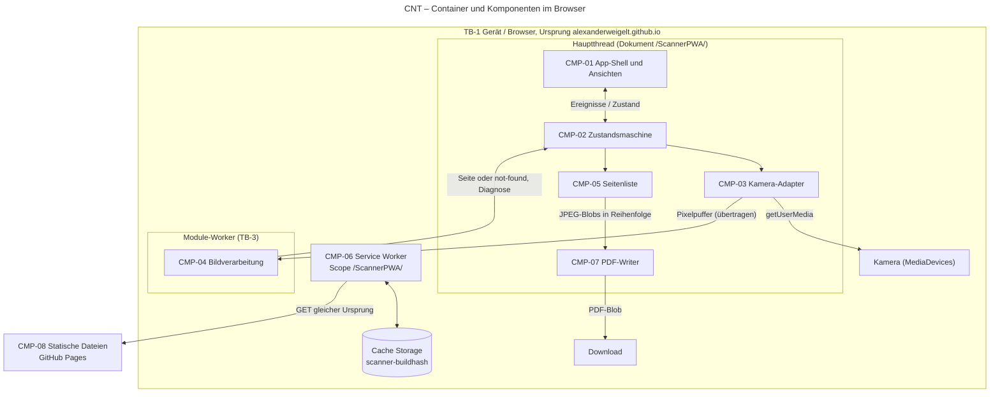
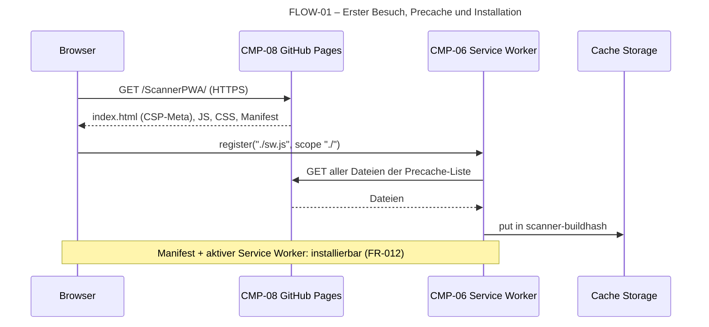
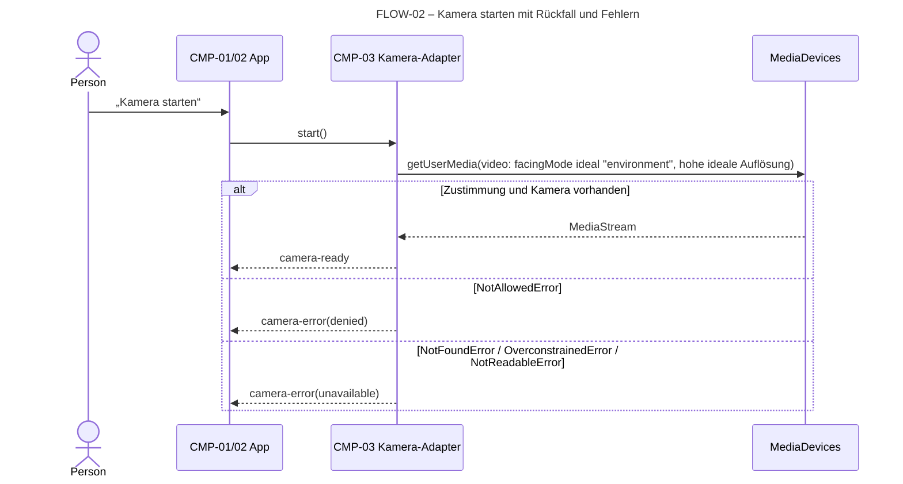
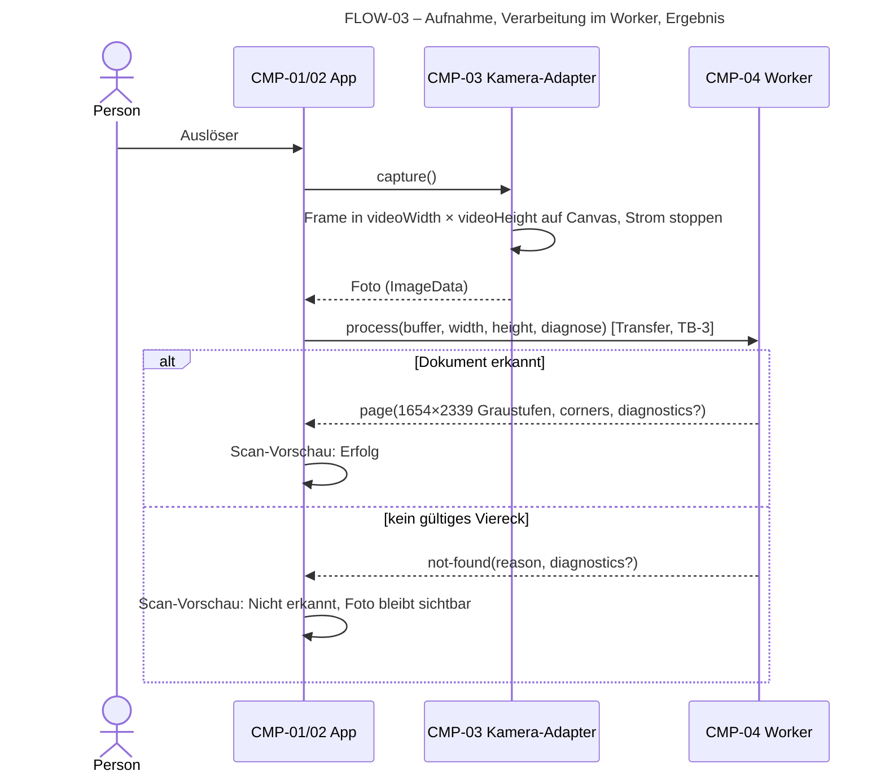
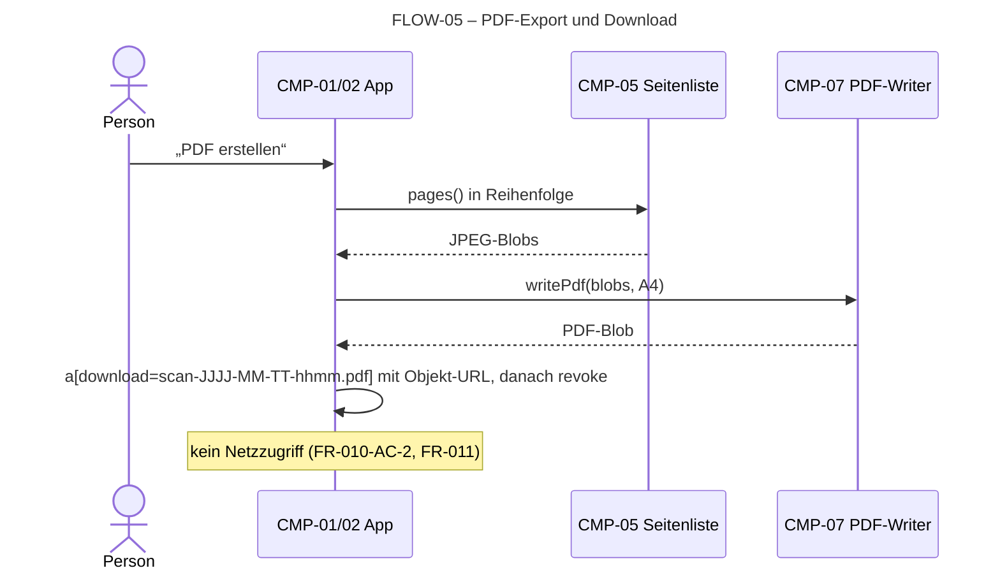
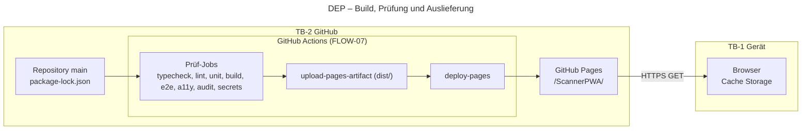

# Architektur – Scanner PWA

Maßgebliche Datei für technische Struktur, Diagramme und Engineering-Regeln.
Aufbau nach arc42 (<https://docs.arc42.org/section-1/>, gelesen 14.10.2026),
nur mit den Abschnitten, die für eine statische Einzelseiten-App nötig sind.
Diagramme nach dem C4-Modell (<https://c4model.com/diagrams>, gelesen
14.10.2026: Context, Container, Dynamic, Deployment) als Mermaid.
Entscheidungen stehen als ADR nach MADR 4.0.0 in [docs/adr](docs/adr/README.md).

Fachliches Verhalten steht in den [Anforderungsdatensätzen](docs/requirements/)
(Überblick [REQUIREMENTS.md](REQUIREMENTS.md)), Gestaltung in
[DESIGN.md](DESIGN.md), offene Fragen im
[Klärungsjournal](docs/clarifications.md). Sicherheitskontrollen und das
Bedrohungsmodell stehen in [SECURITY.md](SECURITY.md); diese Datei liefert dafür
Komponenten, Flüsse und Vertrauensgrenzen.

**Status:** Entscheidungen gelten erst, wenn Alex sie in der jeweiligen ADR
angenommen hat (`accepted`); Stand siehe [ADR-Übersicht](docs/adr/README.md).
Nichts davon ist implementiert.

## 1. Ziele

Scanner PWA fotografiert ein Dokument, macht daraus auf dem Gerät eine flache,
lesbare A4-Seite und lädt ein PDF herunter; Bilder verlassen das Gerät nie
(Zielbild Scanner PWA (angenommen von Alex, 14.10.2026), Abschnitt „Kern“).

Architekturrelevante Qualitätsziele, je mit Anforderung als Quelle:

| Ziel | Woran gemessen | Quelle |
| --- | --- | --- |
| Nur auf dem Gerät | Keine Anfrage mit Bild-/PDF-Daten, keine Anfrage an fremde Ursprünge | [FR-011](docs/requirements/FR-011-on-device-only.md) |
| Offline nach erstem Besuch | Start und Ablauf bis PDF ohne Netz | [FR-013](docs/requirements/FR-013-offline-use.md), [FR-010](docs/requirements/FR-010-export-pdf.md)-AC-2 |
| Unterpfad | Alles lädt aus `/ScannerPWA/`, Installation und Offline-Start dort | [FR-014](docs/requirements/FR-014-subpath-hosting.md) |
| Erkennungsqualität | Referenzbild Erfolg gelingt, Referenzbild Fehler scheitert sauber | [FR-006](docs/requirements/FR-006-detect-and-rectify.md), [FR-008](docs/requirements/FR-008-detection-failure.md), OQ-002 |
| Eindeutige Zustände | Genau ein Zustand, nie ohne Aktion | [FR-015](docs/requirements/FR-015-clear-states.md) |
| Stabiler Speicher | Kein stetiger Anstieg über Scan-Zyklen | [FR-017](docs/requirements/FR-017-stable-memory.md), OQ-005 |
| Zugänglichkeit | WCAG 2.2 AA, Zielkette A11Y-1 bis A11Y-9 | [DESIGN.md](DESIGN.md#zielkette) |

### Zielkette Wartbarkeit und Reproduzierbarkeit

Die gemeinsamen Ziele „korrektes Verhalten“ und „zugängliche Bedienung“ sind in
den FR bzw. in DESIGN.md verankert, „sichere Auslieferung“ steht in [SECURITY.md](SECURITY.md). Diese
Datei verantwortet das Ziel wartbarer Code und reproduzierbare Änderungen:

| Ziel | Messbares Kriterium | Nachweis | Gate | Quelle |
| --- | --- | --- | --- | --- |
| ENG-1 Typsicherheit | 0 Fehler bei `strict` und den Optionen in Abschnitt 10.1 | `npm run typecheck` | CI blockierend, Pre-Push | TypeScript 6.0 ([ADR-0001](docs/adr/ADR-0001-typescript-vite-ohne-ui-framework.md)), <https://www.typescriptlang.org/tsconfig/> |
| ENG-2 Statische Regeln | 0 Lint-Fehler und 0 Warnungen | `npm run lint` | CI blockierend, Pre-Commit | ESLint 10, typescript-eslint 8 (npm 8.71.2, abgefragt 15.10.2026), `strictTypeChecked`, <https://typescript-eslint.io/users/configs/> |
| ENG-3 Reproduzierbarer Build | `npm ci && npm run build` aus sauberem Checkout mit Node 24 erzeugt `dist/` ohne Netz zur Laufzeit; Lockfile unverändert | CI-Job auf frischem Runner | CI blockierend vor Deployment | NIST SSDF 1.1 (SP 800-218), PS.3, PW.6 |
| ENG-4 Kriterien getestet | Jedes AC eines `ready`-FR hat einen Test in `test_refs` oder einen benannten manuellen Nachweis | Spec-Check (P10) | CI blockierend | COMMON CONTRACT, FR-Vorlage |
| ENG-5 Abhängigkeiten geprüft | Kein bekanntes Problem ab Schwere „high“ in Laufzeit- oder Build-Abhängigkeiten | `npm audit --audit-level=high` | CI blockierend | NIST SSDF 1.1, PW.4 |

## 2. Randbedingungen

Extern vorgegeben (Zielbild Scanner PWA (angenommen von Alex, 14.10.2026),
Abschnitt „Rahmenbedingungen“); keine Entscheidungen dieser Datei:

| ID | Vorgabe | Folge für die Architektur |
| --- | --- | --- |
| C-1 | Statische GitHub Page unter `https://alexanderweigelt.github.io/ScannerPWA/` | Keine eigenen HTTP-Header, keine Serverlogik, Unterpfad als Basis |
| C-2 | Keine Serverkomponente, keine Konten, kein Upload | Gesamte Verarbeitung im Browser |
| C-3 | Alle Laufzeit-Ressourcen selbst ausgeliefert | Keine CDNs, keine fremden Schriften oder Skripte |
| C-4 | Kamera nur nach Zustimmung über HTTPS | `getUserMedia` nur auf Nutzeraktion, sicherer Kontext |
| C-5 | Installierbar und offline nach erstem Besuch | Manifest und Service Worker |
| C-6 | Oberflächensprache Deutsch (OQ-001) | Texte nur deutsch, keine Übersetzungsschicht |

Projektkontext: Alex schreibt hauptsächlich TypeScript (Projektnotiz, keine
Anforderung); berücksichtigt in [ADR-0001](docs/adr/ADR-0001-typescript-vite-ohne-ui-framework.md).

## 3. Kontext und Abgrenzung

Die App spricht genau eine Gegenstelle im Netz an: ihren eigenen Ursprung
`https://alexanderweigelt.github.io`, ausschließlich mit `GET` für die
eigenen Dateien unter `/ScannerPWA/`. Bilder, Seiten und PDFs entstehen und
bleiben innerhalb von TB-1. Außerhalb des Umfangs: OCR, Cloud-Speicher,
Konten (siehe [REQUIREMENTS.md, Ausschlüsse](REQUIREMENTS.md#ausschlüsse)).

### Vertrauensgrenzen

| ID | Grenze | Was sie kreuzt |
| --- | --- | --- |
| TB-1 | Gerät und Browser-Sandbox der Person gegenüber dem Netz | Eingehend nur App-Dateien (FLOW-01, FLOW-06); ausgehend nichts. Kamera und Download über Browser-Berechtigungen |
| TB-2 | GitHub (Repository, CI, Pages) gegenüber dem Gerät | Gebaute Dateien über HTTPS; Integrität hängt an Repository, Abhängigkeiten und Workflow (FLOW-07) |
| TB-3 | Hauptthread gegenüber Worker | Pixelpuffer und Ergebnisse als strukturierte Nachrichten; beide gleicher Ursprung, Prüfung der Nachrichtenform an der Grenze |

**Gemeinsamer Ursprung:** `alexanderweigelt.github.io` ist der Ursprung aller
Projektseiten dieses GitHub-Kontos ohne eigene Domain; weitere Pages von Alex
existieren dort (SD-1). Cache Storage, IndexedDB und
Berechtigungen gelten je Ursprung, nicht je Unterpfad. Bewertung in
[SECURITY.md](SECURITY.md) (T-04, SEC-09; Restrisiko von Alex angenommen).

## 4. Lösungsstrategie

| Thema | Ansatz | ADR |
| --- | --- | --- |
| Sprache, Build, UI | TypeScript strict, Vite mit `base: '/ScannerPWA/'`, DOM-APIs direkt, kein UI-Framework | [ADR-0001](docs/adr/ADR-0001-typescript-vite-ohne-ui-framework.md) |
| Zustände | Explizite Zustandsmaschine als diskriminierte Union, eine Ansicht je Zustand | dieser Abschnitt, Abschnitt 8.1 |
| Bildverarbeitung | Eigene Pipeline auf Typed Arrays im Module-Worker; OpenCV.js als Plan B | [ADR-0002](docs/adr/ADR-0002-eigene-bildverarbeitung-im-worker.md) (accepted, OQ-007) |
| PDF | Eigener Writer, JPEG je Seite unverändert eingebettet | [ADR-0003](docs/adr/ADR-0003-eigener-pdf-writer.md) |
| Offline | Eigener Service Worker, Precache der Build-Dateien | [ADR-0004](docs/adr/ADR-0004-eigener-service-worker.md) |
| Auslieferung, CSP | Pages-Workflow; CSP als Meta-Element ohne Inline-Code | [ADR-0005](docs/adr/ADR-0005-pages-deployment-und-csp-meta.md) |
| Tests | Vitest, Playwright (simulierte Kamera), axe-core | [ADR-0006](docs/adr/ADR-0006-testwerkzeuge.md) |
| Diagnose | Nur im Entwicklungs- bzw. Diagnose-Build, nicht in der veröffentlichten App | [ADR-0007](docs/adr/ADR-0007-diagnosemodus-nur-im-entwicklungs-build.md) |
| Plattformen | Aktuelle und vorige Browser-Hauptversion, iOS ≥ 17, Node 24 LTS | [ADR-0008](docs/adr/ADR-0008-unterstuetzte-browser.md) |

Stufe 2 (mehrere Seiten) ist von Beginn an in der Seitenliste (CMP-05)
angelegt; Stufe 1 zeigt sie mit genau einer Seite (DESIGN.md,
„Ansichten und Zustände“). Stufe 3 (`draft`) ist nur über Parameter
vorbereitet (Seitengröße, JPEG-Qualität), nicht gebaut.

## 5. Bausteinsicht

| ID | Baustein | Verantwortung | Schnittstellen | FR |
| --- | --- | --- | --- | --- |
| CMP-01 | App-Shell und Ansichten | `index.html`, fünf Ansichten nach DESIGN.md, Fokusführung, Live-Region, Registrierung des Service Workers, Erkennung der Einbettung im Frame | DOM; abonniert CMP-02 | FR-001, FR-003, FR-004, FR-009, FR-015, FR-016, FR-019, FR-020, FR-027 |
| CMP-02 | Zustandsmaschine | Einziger Zustand der App und erlaubte Übergänge; ruft CMP-03, CMP-04, CMP-05, CMP-07 | `dispatch(event)`, `subscribe(listener)` | FR-015 |
| CMP-03 | Kamera-Adapter | Kamera starten mit Rückfallreihenfolge, Fehler klassifizieren, Bild in voller Stromauflösung einfrieren, Kamera freigeben | `navigator.mediaDevices.getUserMedia`, `HTMLVideoElement`, `HTMLCanvasElement` | FR-001, FR-002, FR-003, FR-004, FR-005 |
| CMP-04 | Bildverarbeitung | Erkennung, Ecken, Entzerrung auf A4 hoch, Scan-Look; Zwischenbilder nur im Diagnosemodus | `postMessage` mit übertragbarem `ArrayBuffer` | FR-006, FR-007, FR-008, FR-016 |
| CMP-05 | Seitenliste | Übernommene Seiten als JPEG-`Blob` im Arbeitsspeicher; hinzufügen, löschen, verschieben; Objekt-URLs verwalten | Methoden in TypeScript, keine Persistenz | FR-009, FR-017, FR-018, FR-019, FR-020 |
| CMP-06 | Service Worker | Precache, Offline-Auslieferung, Update ohne Sitzungsabbruch | `install`, `activate`, `fetch` | FR-012, FR-013, FR-014 |
| CMP-07 | PDF-Writer | PDF aus JPEG-Seiten, A4 hoch, Reihenfolge der Liste, Dateiname nach DESIGN.md | reine Funktion `Blob[] → Blob` | FR-010, FR-021 |
| CMP-08 | Statische Dateien | `index.html` mit CSP, gebündelte Skripte und Styles, `manifest.webmanifest`, Icons (OQ-006), `sw.js` | HTTPS `GET` | FR-011, FR-012, FR-014 |

Geplante Verzeichnisstruktur (Umsetzung ab P10): `src/app/` (CMP-01, CMP-02),
`src/camera/` (CMP-03), `src/processing/` (CMP-04, nur reine Funktionen und
`worker.ts`), `src/pages/` (CMP-05), `src/pdf/` (CMP-07), `src/sw/` (CMP-06),
`public/` (Manifest, Icons), `tests/unit/`, `tests/e2e/`, `tests/fixtures/`.

## 6. Laufzeitsicht

### Zustände (FR-015)

```mermaid
---
title: STATE – Zustände und Übergänge der App
---
stateDiagram-v2
  accTitle: Zustandsmaschine der App
  accDescr: Fünf Zustände nach FR-015 mit Teilzuständen nach DESIGN.md. Jeder Zustand hat mindestens eine Aktion; Fehler bleiben Teilzustände.
  [*] --> Start
  state Start {
    [*] --> Bereit
    [*] --> Eingebettet: im Frame (FR-027)
    Bereit --> Kamerafehler: verweigert / keine Kamera
    Kamerafehler --> Bereit: Zurück
  }
  Start --> KameraAktiv: Kamera starten (Zustimmung)
  Kamerafehler --> KameraAktiv: Erneut versuchen (Zustimmung)
  state KameraAktiv {
    [*] --> Startet
    Startet --> LiveVorschau
  }
  KameraAktiv --> Start: Kamera beenden
  KameraAktiv --> ScanVorschau: Auslöser
  state ScanVorschau {
    [*] --> Verarbeitung
    Verarbeitung --> Erfolg
    Verarbeitung --> NichtErkannt: kein Viereck / Zeitgrenze
  }
  ScanVorschau --> KameraAktiv: Neu aufnehmen
  ScanVorschau --> Seitenliste: Übernehmen
  Seitenliste --> KameraAktiv: Seite hinzufügen
  Seitenliste --> Export: PDF erstellen
  Export --> Seitenliste: Fertig / Abbrechen
```

Der Zustand ist eine diskriminierte Union (`{ kind: 'start' | 'camera' |
'scan-preview' | 'pages' | 'export', … }`) mit Teilzustand als Feld. Übergänge
sind eine reine Funktion `transition(state, event) → state`; Nebenwirkungen
(Kamera, Worker, Download) laufen außerhalb und melden Ergebnisse als
Ereignisse zurück. Nicht erlaubte Ereignisse ändern den Zustand nicht. So ist
FR-015-AC-1 als Unit-Test über alle Ereignisse prüfbar.

### FLOW-01 Erster Besuch und Installation

### FLOW-02 Kamera starten

`facingMode` als `ideal` (nicht `exact`) liefert die Rückkamera, wenn
vorhanden, sonst eine andere Kamera, ohne Auswahl durch die Person
(FR-002-AC-1, FR-002-AC-2). Den Vorrang Front- vor Webcam (FR-002-AC-3,
Antwort von Alex auf OQ-008) setzt CMP-03 selbst durch: Ist die gelieferte
Kamera keine Rückkamera, liest er nach der Zustimmung die Richtung aller
Kameras (`getCapabilities().facingMode` bzw. `getSettings().facingMode`) und
wechselt ohne Rückfrage auf eine Kamera mit `user`, falls vorhanden. Kameras
ohne gemeldete Richtung gelten als Webcam. Nachweis manuell auf echten
Geräten (Abschnitt 10.4); die simulierte Kamera im Browser-Test meldet keine
Richtung. Vor der Aktion wird nie `getUserMedia`
aufgerufen (FR-001-AC-1); läuft die App im Frame einer anderen Seite, bleibt
sie im Teilzustand „Eingebettet“ und ruft `getUserMedia` nie auf (FR-027,
SECURITY.md SEC-08). Beim Verlassen des Zustands „Kamera aktiv“ werden
alle Tracks mit `stop()` beendet (FR-003-AC-2).

### FLOW-03 Aufnehmen und Verarbeiten

Der Worker prüft eingehende Nachrichten an der Grenze TB-3 auf Form und
Grenzen und antwortet sonst mit einem Fehler statt zu rechnen; die Grenzwerte
legt [SECURITY.md](SECURITY.md) SEC-10 fest.

### FLOW-04 Übernehmen und Seitenliste

„Übernehmen“ kodiert die Seite einmal als JPEG (`canvas.toBlob`, Qualität nach
ADR-0003) und hängt sie an CMP-05 an (FR-009-AC-3, FR-018). Der Pixelpuffer
wird danach verworfen. Löschen entfernt den Blob und widerruft seine
Objekt-URL (FR-019); Verschieben ändert nur die Reihenfolge der Liste (FR-020).

### FLOW-05 PDF-Export

### FLOW-06 Offline-Start und Update

Bei jedem Start beantwortet CMP-06 Navigationen im Scope mit dem gecachten
`index.html` und alle übrigen Anfragen aus dem Cache; erst bei einem Fehltreffer
geht eine Anfrage ans Netz (gleicher Ursprung). Ist online ein neuer Build
verfügbar, installiert sich der neue Service Worker im Hintergrund und wartet;
er übernimmt beim nächsten Start (ADR-0004). Eine laufende Sitzung wird nicht
neu geladen, damit keine Seiten verloren gehen.

### FLOW-07 Build und Deployment

Siehe Abschnitt 7.

## 7. Verteilungssicht

| Element | Festlegung |
| --- | --- |
| Quelle | Branch `main`; Änderungen nur per PR (Arbeitsweise Alex, Journal) |
| Workflow | `.github/workflows/` (Einrichtung P10); Deploy-Job mit `pages: write`, `id-token: write`, sonst `contents: read`; Actions auf Commit-SHA festgelegt |
| Artefakt | Inhalt von `dist/` nach `npm ci && npm run build` |
| Laufzeit | Nur statische Dateien; Browser hält sie in Cache Storage |
| Pages-Einstellung | Quelle „GitHub Actions“ im Repository (manuelle Einstellung durch Alex, P10) |

## 8. Querschnittliche Konzepte

### 8.1 Zustand und Fehler

Ein Zustand, eine Ansicht, eine `h1` (DESIGN.md). Fehler sind Daten im
Teilzustand (`{ kind: 'start', error: 'denied' | 'unavailable' }`,
`{ kind: 'scan-preview', result: 'not-found', reason }`), keine Ausnahmen
quer durch die Oberfläche. Unerwartete Ausnahmen in Worker oder Export führen
in den Teilzustand des aktuellen Zustands mit „Erneut versuchen“ bzw.
„Neu aufnehmen“, nie in eine Ansicht ohne Aktion.

Abbruch und Zeitgrenze (FR-015-AC-2/AC-3, Antwort von Alex auf OQ-009):
„Neu aufnehmen“ während der Verarbeitung beendet den Worker (`terminate()`)
und startet für die nächste Aufnahme einen neuen; Ergebnisse einer
abgebrochenen Verarbeitung werden verworfen. CMP-07 schreibt das PDF
seitenweise asynchron und prüft zwischen den Seiten ein `AbortSignal`, damit
„Abbrechen“ und die Zeitgrenze wirken. Die Zeitgrenze überwacht CMP-02 mit
einem Zeitgeber je Vorgang; ihr Wert ist UNKNOWN bis zur Messung auf einem
echten Gerät (R-02, OQ-010).

### 8.2 Speicher (FR-017)

* Höchstens ein Foto in voller Auflösung zur Zeit; der Puffer wird an den Worker übertragen, nicht kopiert.
* Kamera-Tracks werden beim Verlassen von „Kamera aktiv“ gestoppt.
* Seiten liegen nur als JPEG-`Blob` vor (ca. einige hundert kB statt ca. 15 MB Rohpixel bei 1654 × 2339 × 4).
* Jede `URL.createObjectURL` hat ein zugehöriges `revokeObjectURL`; Canvas-Hilfsflächen werden nach Gebrauch auf 0 × 0 gesetzt.
* Messverfahren (Vorschlag zu OQ-005, keine Antwort): Playwright Chromium, nach 5 Aufwärmzyklen Garbage Collection per DevTools-Protokoll, dann 20 Zyklen Aufnehmen–Verarbeiten–Verwerfen; `JSHeapUsedSize` nach erneuter Garbage Collection höchstens 10 % über dem Ausgangswert.
* Ergänzung (Vorschlag, FIND-022): `JSHeapUsedSize` erfasst Speicher hinter `Blob`, `ImageData` und Canvas nicht vollständig. Deshalb zählt der Test zusätzlich über eine nur im Testbuild aktive Zählung offene Objekt-URLs und Canvas-Flächen größer 0 × 0; beide müssen nach jedem Zyklus auf den Ausgangswert zurückgehen.

### 8.3 Offline, Speicherorte, Unterpfad

* Alle Pfade relativ zur Basis `/ScannerPWA/` (Vite `base`, Manifest `start_url` und `scope` `./`, Service-Worker-Scope `./`).
* Speicherorte: nur Cache Storage für App-Dateien. Keine Bilddaten in `localStorage`, IndexedDB oder Cache Storage (FR-011, OQ-004); FR-026 (Stufe 3) braucht dafür eine eigene Entscheidung.
* Keine Laufzeit-Caches für andere Anfragen.

### 8.4 Diagnosemodus (FR-016)

Nur im Entwicklungsserver und im Build `vite build --mode diagnose`
(ADR-0007); der veröffentlichte Produktions-Build enthält keinen Diagnose-Code.
Im Diagnose-Build liefert der Worker Kantenbild,
Kandidaten und gewählte Ecken als zusätzliche Puffer; CMP-01 zeigt sie im
`diagnostic-panel`. Im Produktions-Build werden sie weder berechnet noch
übertragen.

### 8.5 Zugänglichkeit

Umsetzung der Zielkette A11Y-1 bis A11Y-9 aus DESIGN.md: native Elemente,
Fokus nach Ansichtswechsel auf `h1`, eine Live-Region für Statusmeldungen,
`lang="de"`, Seitentitel je Ansicht. Prüfung siehe Abschnitt 10.4.

## 9. Architekturentscheidungen

Siehe [docs/adr](docs/adr/README.md). Alle acht ADRs hat Alex am 14.10.2026
einzeln per Auswahl entschieden (`accepted`); Belege im
[Journal, Antworten](docs/clarifications.md#antworten).

## 10. Engineering-Regeln und geplante Gates

Diese Regeln sind der Kommandovertrag für AGENTS.md (P09). Sie sind
**festgelegt, aber nicht eingerichtet**; P10 legt Werkzeuge und CI an und
berichtet tatsächliche Ausführung.

### 10.1 TypeScript

* `tsconfig.json`: `strict: true`, `noImplicitAny` (über `strict`), `noUncheckedIndexedAccess`, `exactOptionalPropertyTypes`, `noImplicitOverride`, `noFallthroughCasesInSwitch`, `useUnknownInCatchVariables`, `verbatimModuleSyntax`, `isolatedModules`, `noEmit` (Vite baut).
* Getrennte Projekte bzw. `lib`-Einstellungen für Dokument (`DOM`), Worker (`WebWorker`) und Service Worker (`WebWorker`), damit z. B. `document` im Worker ein Typfehler ist.
* Kein `any`. `@ts-expect-error` nur mit Begründung im Kommentar; `@ts-ignore` verboten.
* Typzusicherungen (`as`) nur an benannten externen Grenzen, gekapselt in je einer Funktion mit Laufzeitprüfung: Worker-Nachrichten (`src/processing/messages.ts`), `MediaStreamTrack.getSettings()`, Service-Worker-Ereignisse. Jede Ausnahme ist dort kommentiert.

### 10.2 Lint und Format

* ESLint 10 mit `typescript-eslint` `strictTypeChecked` und `stylisticTypeChecked`; zusätzlich als Fehler: `@typescript-eslint/no-explicit-any`, `no-unsafe-*`, `consistent-type-assertions` (`assertionStyle: 'as'`, `objectLiteralTypeAssertions: 'never'`), `no-floating-promises`.
* Verbotene DOM-Ausgaben und dynamische Codeausführung per `no-restricted-properties`/`no-restricted-syntax` (maßgebliche Liste für SECURITY.md SEC-04): `innerHTML`, `outerHTML`, `insertAdjacentHTML`, `setHTMLUnsafe`, `Range.createContextualFragment`, `srcdoc`, `document.write`, `eval`, `new Function`, String-Argumente für `setTimeout` und `setInterval`. Texte nur über `textContent`, Elemente über `createElement`.
* Netz-APIs in Worker und Service Worker (SECURITY.md SEC-05): im Bildverarbeitungs-Worker (`src/processing/`) keine `fetch`, `XMLHttpRequest`, `WebSocket`, `EventSource`, `importScripts`; im Service Worker (`src/sw/`) `fetch` nur für Anfragen des eigenen Ursprungs. Grund: Das CSP-Meta-Element gilt nur für das Dokument, nicht für Worker (FIND-015).
* Prettier für Formatierung; `--max-warnings 0`.

### 10.3 Eingaben, Ausgabe, Ursprung, Transport

* **Untrusted Eingaben** an tatsächlichen Grenzen: Kamerabild (nur als Pixel verarbeitet, Größe begrenzt), Worker-Nachrichten (Form- und Grenzprüfung, TB-3), URL-Parameter (werden nicht ausgewertet). Es gibt keine Datei-Uploads, Formulare oder fremden Daten.
* **Ausgabe:** nur sichere DOM-APIs (10.2). Bilder über Objekt-URLs (`blob:`) aus eigenen Blobs.
* **Geheimnisse:** keine. Der Client enthält keine Schlüssel; CI braucht nur das automatische `GITHUB_TOKEN` mit minimalen Rechten. Secret-Scan als Gate.
* **CSP:** Meta-Element in `index.html`, Wert in ADR-0005; Vite-Build ohne Inline-Skripte und -Styles (`build.modulePreload.polyfill: false` bzw. Prüfung des Builds), keine Hashes oder Nonces nötig.
* **Ursprung/CORS:** einziger Ursprung ist der eigene; keine CORS-Anfragen, `connect-src 'self'`. Der Service Worker bearbeitet nur Anfragen des eigenen Ursprungs.
* **Transport:** GitHub Pages liefert über HTTPS; `http://` leitet um. HSTS und `nosniff` setzt GitHub Pages oder nicht – nicht konfigurierbar, per Header-Test zu belegen (R-04).

### 10.4 Geplante Kommandos und Gates

| Kommando (geplant) | Zweck | Belegt | Wo blockierend |
| --- | --- | --- | --- |
| `npm ci` | Reproduzierbare Installation aus `package-lock.json` | ENG-3 | CI |
| `npm run typecheck` (`tsc -b --noEmit`) | Typprüfung aller Teilprojekte | ENG-1 | CI, Pre-Push |
| `npm run lint` (`eslint . --max-warnings 0`) | Regeln 10.2 | ENG-2 | CI, Pre-Commit |
| `npm run format:check` (`prettier --check .`) | Format | ENG-2 | CI |
| `npm run test:unit` (`vitest run`) | Zustandsmaschine, Pipeline-Stufen, Referenzbilder (FR-006/007/008-AC), PDF-Struktur (FR-010-AC-1, FR-021-AC-1), Seitenliste (FR-018 bis FR-020) | AC-Tests | CI, Pre-Push |
| `npm run build` (`vite build`) + Build-Prüfung | `dist/` mit Basis `/ScannerPWA/`, CSP-Meta vorhanden, kein Inline-Skript, Precache-Liste vollständig | ENG-3, FR-014 | CI vor Deployment |
| `npm run test:e2e` (`playwright test`) | Ablauf in Chromium (Desktop, Smartphone-Profil, simulierte Kamera), Firefox, WebKit (iPhone-Profil, ohne Kamera); `vite preview` unter `/ScannerPWA/`; Offline (FR-013), Netzmitschnitt (FR-011), Sicherheitsprüfungen laut SECURITY.md Abschnitt 7 (u. a. App im `iframe`, CSP-Verstöße, Speicherinhalt), Diagnose (FR-016-AC-1 gegen Diagnose-Build, FR-016-AC-2 gegen Produktions-Build), Fokus und Live-Region (A11Y-2, A11Y-8), Installierbarkeit in Chromium (FR-012-AC-1; Annahme, in P10 zu prüfen: DevTools-Protokoll `Page.getInstallabilityErrors` liefert eine leere Liste), App im `iframe` (FR-027) | AC-Tests | CI |
| `npm run test:a11y` (Playwright + `@axe-core/playwright`, Tags `wcag2a`, `wcag2aa`, `wcag21aa`, `wcag22aa`) | Scan aller Ansichten und Teilzustände (DESIGN.md) im Desktop- und Smartphone-Format | A11Y-1, -3, -7, -9 | CI |
| `npm run test:memory` | Messverfahren 8.2 (Chromium) | FR-017 | CI, sobald OQ-005 beantwortet |
| `npm run test:deployed` (Playwright gegen `https://alexanderweigelt.github.io/ScannerPWA/`) | Antwortheader (HSTS, `nosniff`, `Content-Type`) und HTTPS-Umleitung, TLS-Probe je Protokollversion (`openssl s_client`, Gültigkeit nach SECURITY.md SEC-01), CSP-Meta in ausgelieferter Seite, Ressourcen unter Unterpfad, Offline-Start (FR-014-AC-1) | Auslieferung | nach Deployment; Fehlschlag meldet, sperrt nicht rückwirkend |
| `npm audit --audit-level=high` | bekannte Schwachstellen | ENG-5 | CI |
| `npx secretlint "**/*"` | Secret-Scan des Repositorys | 10.3 | CI, Pre-Commit |
| `npm run check:spec` | FR/AC/OQ/ADR-IDs, `test_refs`, relative Links (P10) | ENG-4 | CI |

Lokale Hooks per `simple-git-hooks`: Pre-Commit `lint` und Secret-Scan,
Pre-Push `typecheck` und `test:unit`. Hooks ersetzen CI nicht.

Manuelle Gates (Verantwortung Maintainer, Vorschlag Alex; Ergebnis im
Journal): Kamera auf echtem Android-Smartphone und iPhone sowie Laptop-Webcam
(FR-002 einschließlich AC-3 auf einem Gerät ohne Rückkamera, FR-003, FR-005, FR-012-AC-2), Screenreader- und Zoomprüfung nach
DESIGN.md.

### 10.5 Abhängigkeiten, Laufzeiten, Build

* **Lockfile:** `package-lock.json` ist eingecheckt; CI nutzt ausschließlich `npm ci`. Versionen in `package.json` exakt (`save-exact=true` in `.npmrc`).
* **Laufzeitabhängigkeiten:** keine geplant (`dependencies` leer). Jede neue Laufzeitabhängigkeit braucht eine ADR.
* **Build-Abhängigkeiten:** nur die in ADR-0001, ADR-0006 und hier genannten Werkzeuge (Vite, TypeScript, ESLint, typescript-eslint, Prettier, Vitest, Playwright, axe-core, secretlint, simple-git-hooks).
* **Aktualisierung:** per PR mit vollständigem Gate-Lauf; Dependabot für npm und GitHub Actions (von Alex entschieden, SECURITY.md SD-6; Einrichtung P10), Fristen nach SECURITY.md SD-5.
* **Laufzeiten:** Node 24 LTS (`engines`, `.nvmrc`); Browser nach ADR-0008.
* **Reproduzierbarer Build:** keine Zeitstempel oder Zufallswerte im Bundle außer dem Inhalts-Hash; Build-Version im Service Worker ist der Hash der Precache-Liste.

## 11. Risiken und offene Annahmen

| ID | Risiko / Annahme | Folge | Umgang |
| --- | --- | --- | --- |
| R-01 | Eigene Erkennung erreicht auf realen Fotos nicht die nötige Qualität (früherer Stand scheiterte, Ursache unbekannt) | FR-006 nicht erfüllt | Referenzbilder früh (OQ-002), Diagnosemodus, Plan B OpenCV.js laut ADR-0002 |
| R-02 | Rechenzeit der Pipeline auf älteren Smartphones | lange Verarbeitung | Arbeitskopie ≤ 1000 px für Erkennung; Messung auf echtem Gerät |
| R-03 | iOS Safari: Kameraverhalten in installierter PWA, Download-Verhalten | FR-001, FR-010 auf iOS | Manuelle Prüfung auf echtem iPhone |
| R-04 | Antwortheader von GitHub Pages (HSTS, `nosniff`, Cache-Header) sind UNKNOWN; aus dieser Umgebung nicht abrufbar | Lücken in sicherer Auslieferung | Header-Test `test:deployed`; SECURITY.md T-01, T-06, SEC-02, SEC-06 |
| R-05 | Gemeinsamer Ursprung mit anderen Projektseiten von `alexanderweigelt.github.io` | Andere Seiten desselben Ursprungs können Caches und Speicher lesen oder Service Worker in ihrem Pfad registrieren | SECURITY.md T-04, SEC-09: Restrisiko von Alex ohne Gate angenommen (SD-1b) |
| R-06 | Kein `frame-ancestors` per Meta-Element | Einbettung in fremde Seiten nicht verhinderbar | SECURITY.md T-05, SEC-08: keine Kamera im Frame (SD-2) |
| R-07 | Lieferkette der Build-Werkzeuge (npm, Actions) | Manipulierter Build | SECURITY.md T-08, T-09, SEC-16 bis SEC-18 |
| R-08 | Offene Fragen (OQ-002, OQ-005, OQ-006) | Tests unvollständig | P06/P07 |

R-04 bis R-07, Speicherorte (OQ-004) und CSP-Wert (ADR-0005, unverändert übernommen) sind in [SECURITY.md](SECURITY.md) bewertet.

## 12. Abdeckung

| FR | Bausteine | Fluss | Hinweis |
| --- | --- | --- | --- |
| FR-001 | CMP-01, CMP-03 | FLOW-02 | |
| FR-002 | CMP-03 | FLOW-02 | Front vor Webcam durch CMP-03 (OQ-008), Nachweis manuell |
| FR-003 | CMP-01, CMP-03 | FLOW-02 | Hochformat = Rahmen (FIND-007) |
| FR-004 | CMP-02, CMP-03 | FLOW-02 | |
| FR-005 | CMP-03 | FLOW-03 | |
| FR-006 | CMP-04 | FLOW-03 | ADR-0002, OQ-002 |
| FR-007 | CMP-04, CMP-07 | FLOW-03, FLOW-04 | |
| FR-008 | CMP-02, CMP-04 | FLOW-03 | |
| FR-009 | CMP-01, CMP-05 | FLOW-04 | |
| FR-010 | CMP-07 | FLOW-05 | |
| FR-011 | CMP-06, CMP-08 | alle | CSP `connect-src 'self'`, Netzmitschnitt |
| FR-012 | CMP-06, CMP-08 | FLOW-01 | Icon: OQ-006 |
| FR-013 | CMP-06 | FLOW-01, FLOW-06 | |
| FR-014 | CMP-06, CMP-08 | FLOW-01, FLOW-07 | |
| FR-015 | CMP-02 | STATE | |
| FR-016 | CMP-01, CMP-04 | FLOW-03 | ADR-0007 |
| FR-017 | CMP-03, CMP-04, CMP-05 | FLOW-03, FLOW-04 | 8.2, OQ-005 |
| FR-018 | CMP-05 | FLOW-04 | |
| FR-019 | CMP-05 | FLOW-04 | |
| FR-020 | CMP-05 | FLOW-04 | |
| FR-021 | CMP-07 | FLOW-05 | |
| FR-027 | CMP-01, CMP-02 | FLOW-02 | SECURITY.md SEC-08 |
| FR-022 bis FR-026 | – | – | `draft`, Stufe 3; vorbereitet nur durch Parameter in CMP-07; FR-026 braucht Speicherentscheidung (OQ-004) |
